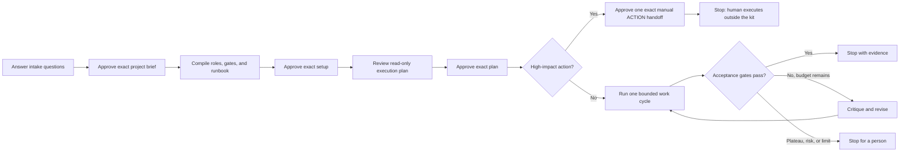

# Tempered Loop

**Build. Test. Temper. Stop on evidence.**

[](https://github.com/pnmcguire480/tempered-loop/actions/workflows/validate.yml)
[](LICENSE)
[](https://github.com/pnmcguire480/tempered-loop/releases/tag/v0.1.0)

The Tempered Loop is more useful as a harness than as a magic prompt: define an inspectable bar, split ownership, keep builders and critics separate, inspect the real artifact, and stop on evidence or budget.

This repository packages that workflow natively for **Claude Code, Cursor, Codex, and Qwen Code**. Each host gets an adaptive project interview, a setup compiler, specialist roles, measurable acceptance gates, three staged approval boundaries, and a separate best-effort single-delivery manual-handoff gate for high-impact actions.

> **Status:** experimental public preview v0.1.0 using Tempered wire protocol v2. Static and adversarial checks pass locally, but no complete happy path has yet been verified across all four supported hosts. These prompts are not a host security boundary. Live behavior depends on your installed host, model, tools, permissions, project, and budget. Start in a disposable project and read the [threat model](THREAT-MODEL.md).

## 60-second quick start

1. [Download the v0.1.0 public preview](https://github.com/pnmcguire480/tempered-loop/releases/tag/v0.1.0) and extract it.
2. Decide whether the project is new, already trusted, or unfamiliar. For an unfamiliar repository, **do not open it normally in an agent host**; use the clean-bootstrap procedure in [THREAT-MODEL.md](THREAT-MODEL.md).
3. Pick **one** platform and copy its complete hidden configuration folder into a new or trusted project. This includes the bundled verification helper.
4. Follow [Find the trusted Python path](PYTHON-SETUP.md) to identify one full absolute Python 3.10+ executable path outside the project. Do not let the project or agent find it through PATH, do not use the project's virtual environment, and reject a symlink, shortcut, junction, or reparse-point path. Keep that same path as `<trusted-absolute-python>`, restart the coding-agent host, and run the adapter guide's helper self-test with `-I -S -B`. During each approval preview, allow only the helper's clearly named scratch directory in your operating-system temporary folder; never allow project-local scratch or a broader permission change.
5. Run Part 1, save its receipt outside the project, then start a fresh chat and run Part 2.

| Platform | Copy into your project | Part 1 | Part 2 | Detailed guide |
|---|---|---|---|---|
| Claude Code | `claude/.claude` | `/tempered-intake` | `/tempered-compile` | [Claude guide](claude/README.md) |
| Cursor | `cursor/.cursor` | `/tempered-intake` | `/tempered-compile` | [Cursor guide](cursor/README.md) |
| Codex | `codex/.agents` | `$tempered-intake` | `$tempered-compile` | [Codex guide](codex/README.md) |
| Qwen Code | `qwen/.qwen` | `/tempered:intake` | `/tempered:compile` | [Qwen guide](qwen/README.md) |

For the extra-simple version, read [00-START-HERE.txt](00-START-HERE.txt).

Do not install all four configurations unless you deliberately want four separate host setups. If the destination folder already exists, stop and review the files instead of replacing it blindly. Upgrading from the earlier kit requires a clean protocol migration; see [MIGRATION.md](MIGRATION.md).

## How it works



The two reusable entry points never begin project implementation:

- **Part 1 — Intake:** asks adaptive questions for a new project or an audit/revamp, turns vague goals into observable gates, and writes only an approved project brief.
- **Part 2 — Compiler:** reads that brief in a fresh session and generates project-specific roles, ownership, acceptance gates, runbook, status ledger, and execution prompt.
- **Execution:** begins only after a fresh session verifies the setup and the user approves the exact read-only execution plan. Destructive, production, publishing, migration, secret, external-message, and other high-impact steps are never agent-executed in v0.1.0; a separate ACTION approval permits only a best-effort single delivery of an exact `NOT EXECUTED` manual handoff, then the kit stops.

## What you get

- Adaptive intake for both new projects and audit/revamp work.
- Native project-local entry points for four coding-agent hosts.
- Project-specific explorer, builder, verifier, critic, integrator, and coordinator roles.
- Deterministic checks before model or human judgment.
- Content-bound protocol-v2 approvals using IDs, revisions, SHA-256, and fresh nonces.
- User-carried `TEMPERED BRIEF`, `TEMPERED SETUP`, and artifact-bound `TEMPERED PLAN` receipts between fresh sessions.
- A bundled deterministic helper for random nonces, exact-byte hashing, portable-path checks, artifact snapshots, and a confined operating-system-temp preview directory; the model does not calculate these values itself.
- Explicit ownership and isolation rules for parallel writers.
- Safe sequential fallbacks when real isolation is unavailable.
- Finite critique/revision budgets and plateau stopping.
- Human stops and manual-only handoffs for destructive, production, publishing, migration, secret, scope, permission, and budget changes.
- Honest capability detection: unsupported host features are downgraded or blocked, never invented by the prompt.

The complete shared contract is in [COMMON-TEMPERED-CONTRACT.md](COMMON-TEMPERED-CONTRACT.md). Its security assumptions and limits are in [THREAT-MODEL.md](THREAT-MODEL.md).

## Why the receipts?

A mutable repository should not be treated as the current user's approval channel.

Each gate binds the exact candidate bytes to an ID, revision, SHA-256 digest, and fresh nonce. The PLAN receipt also binds the immutable control bundle, an exact artifact snapshot, and the current Git identity. After an approved write is re-read and verified, the host emits a receipt. You keep that receipt **outside the repository** and present it in a later fresh user turn. The next session asks for that receipt before reading additional project authority, independently checks the installed helper against its `HELPER_SHA256`, and only then uses the helper to recompute the remaining files and fields.

The receipt is not a secret: most of its fields are intentionally recomputable from approved files. Its authority comes from a compliant host requiring the **current user** to carry and send it in a fresh turn after local recomputation. This makes stale or edited state easier to catch, but a compromised or noncompliant host can forge the ceremony. The host sandbox and human review remain the real enforcement.

Before a digest-bound approval can exist, the helper needs exact candidate bytes and path lists to hash. It creates one randomly named scratch directory in the operating-system temporary folder, outside the project, for the active revision. Review the host's exact temp-directory requests. Only its fixed candidate/path-list/digest-input filenames are allowed. Corrections discard that stage and rotate the nonce; a successful approved write is compared byte-for-byte with it before it is removed. If the host cannot confine this lifecycle to that one helper-issued path, the workflow stops.

## What this is not

- Not a guarantee of correctness, security, visual quality, or autonomous completion.
- Not proof that more agents always produce better work.
- Not an unlimited “loop until perfect” instruction.
- Not a way to neutralize repository instructions that the host already loaded as trusted.
- Not a replacement for tests, sandboxes, backups, code review, or human product judgment.
- Not equivalent in plain web chat without filesystem, tool, permission, and orchestration support.
- Not evidence that same-model critics are independent; they remain correlated judges.

Benchmark contributions—including negative results—are welcome.

## Native host choices

| Host | Native front door | Generated specialists | Safe continuation baseline |
|---|---|---|---|
| Claude Code | `.claude/skills/` | `.claude/agents/` | One authenticated manual cycle at a time; risky automation modes remain outside normal kit mode. |
| Cursor | `.cursor/skills/` | `.cursor/agents/` | Manual finite local cycles; writers need verified isolation and remote/cloud execution is unsupported in this public preview. |
| Codex | `.agents/skills/` | `.codex/agents/*.toml` | Goal mode is persistence, not automatically a hard budget ceiling; unverified writers run sequentially. |
| Qwen Code | `.qwen/commands/` | `.qwen/agents/` | One local cycle at a time; depth-one specialists only, with Goal requiring verified state preservation and a real outer ceiling. |

A prompt cannot manufacture concurrency, worktrees, vision, browser access, persistence, a sandbox, or permission enforcement. Every intake records what the installed surface actually provides.

## Repository layout

```text
tempered-loop/
  00-START-HERE.txt
  COMMON-TEMPERED-CONTRACT.md
  THREAT-MODEL.md
  MIGRATION.md
  VALIDATION.md
  claude/.claude/{skills,tempered-tools}/
  cursor/.cursor/{skills,tempered-tools}/
  codex/.agents/{skills,tempered-tools}/
  qwen/.qwen/{commands/tempered,tempered-tools}/
  scripts/validate.py
  tests/
```

Part 2 generates project-specific agents and immutable control files only after exact setup approval. `PROJECT_BRIEF.md` is immutable Part 1 input and is never silently regenerated by Part 2. `APPROVED_SETUP.md`, `APPROVED_PLAN.md`, and `CONTROL_BUNDLE.manifest` preserve approved authority; mutable `STATUS.md` never reconstructs it. `RESOURCES.md` assigns shared ports, databases, caches, credentials, services, and other non-Git state.

## Validation

Run the same dependency-free check used in CI:

```text
<trusted-absolute-python> -I -S -B scripts/validate.py
<trusted-absolute-python> -I -S -B -m unittest discover -s tests -p "test_*.py" -v
```

Replace `<trusted-absolute-python>` with the full user/host-known executable path described in the quick start. Never run these checks through a bare `python`, `python3`, or `py` PATH lookup or a project interpreter.

It checks the frozen public manifest, strict UTF-8/LF text, frontmatter, local links, Markdown fences, exact protocol-v2 token grammar, public-path hygiene, helper consistency, and key integrity-contract clauses. The adversarial test suite also proves that malformed receipts, stale schemas, legacy executable names, path traversal, and tampered snapshots are rejected. See [VALIDATION.md](VALIDATION.md) for the boundary of those checks and the first live-host smoke test.

## FAQ

<details>
<summary><strong>Is this a magic prompt?</strong></summary>

No. The reusable value is the workflow around the prompt: explicit gates, ownership, evidence, critique, budgets, and stops.
</details>

<details>
<summary><strong>Why are there three approval gates?</strong></summary>

Approving the problem definition, approving generated infrastructure, and approving actual project work are three materially different decisions.

High-impact actions are manual-only manual handoffs in v0.1.0. The agent never executes them and makes no process call. Exact approval authorizes only the digest-bound, stage-bound chat handoff; root-bound `preview-consume` runs immediately before output labeled `NOT EXECUTED` and `HANDED_OFF/EXECUTION_UNKNOWN`. A human executes out-of-agent, outside kit enforcement. A crash or ambiguous delivery gets no cleanup and needs a new revision; PLAN never authorizes it, and completion is never inferred without later human-attested evidence. Delivery is best-effort single-delivery during a compliant, untampered helper lifecycle, not a security guarantee or durable replay protection. The same OS principal can reverse or recreate stage state, so human idempotency and replay controls are required because duplicate execution may occur.
</details>

<details>
<summary><strong>Can it run unattended?</strong></summary>

The safe baseline is one authenticated, bounded cycle at a time. A host-specific persistence feature is offered only when its state and ceiling behavior are verified.
</details>

<details>
<summary><strong>Why save receipts outside the repository?</strong></summary>

Because repository content is mutable and potentially prompt-injected. A later session requires the user to carry the receipt across the trust boundary.
</details>

<details>
<summary><strong>Has this been benchmarked?</strong></summary>

Not yet. v0.1.0 preview checks cover packaging, protocol consistency, adversarial fixtures, and host-documentation review—not comparative quality benchmarks or four-host end-to-end validation. Please share reproducible positive or negative results through an issue or discussion.
</details>

## Origin and attribution

This independent implementation was inspired by Matt Shumer's [Gauntlet Loop write-up](https://somethingbig.ai/gauntlet-loop) and [Claude of Duty experiment](https://github.com/mshumer/Claude-of-Duty). This repository adds its own cross-platform adapters, two-part intake/compiler architecture, content-bound receipt chain, finite stopping contract, and host capability fallbacks.

Read the original experiment's [honest assessment](https://github.com/mshumer/Claude-of-Duty#honest-assessment), too: evidence and ownership matter more than blind fan-out.

See [NOTICE.md](NOTICE.md) for attribution and non-affiliation details.

## Contributing

Bug reports, platform corrections, adversarial audits, benchmark cases, and clearer beginner documentation are welcome. Read [CONTRIBUTING.md](CONTRIBUTING.md) and [SECURITY.md](SECURITY.md) first.

If this helps your workflow, consider starring the repository and sharing what worked—and what did not.

## License

Released under the [MIT License](LICENSE).
